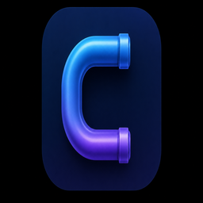

<p align="center">
  
</p>

<h1 align="center">Conduit</h1>

<p align="center">
  Windows desktop utility: local HTTP CONNECT proxy with TLS fragmentation, SOCKS5/MASQUE proxies, AI DPI strategy selector, DNS-over-HTTPS, and an embedded YouTube viewer (Wails v3 / WebView2).<br>
  <strong>33 languages</strong> · Full system-tray control · Reproducible builds
</p>

<p align="center">
  <a href="https://github.com/foursecondfivefour/conduit/releases/latest"></a>
  <a href="https://github.com/foursecondfivefour/conduit/actions/workflows/ci.yml"></a>
  <a href="https://github.com/foursecondfivefour/conduit/actions/workflows/security.yml"></a>
  <a href="LICENSE"></a>
</p>

Designed for a small footprint: one WebView window, mobile YouTube UI, full system-tray control. Release builds run without a console window.

## Download

- **Portable:** `conduit.exe` + `conduit-updater.exe` from [Latest release](https://github.com/foursecondfivefour/conduit/releases/latest)
- **Installer:** `Conduit-Setup-&lt;version&gt;.exe` from [Releases](https://github.com/foursecondfivefour/conduit/releases) (installs to `%LocalAppData%\Programs\Conduit\`)

Requires [WebView2 Runtime](https://developer.microsoft.com/microsoft-edge/webview2/).

> Unsigned builds may show a SmartScreen prompt on first run. See [docs/CODE_SIGNING.md](docs/CODE_SIGNING.md).

## Features (v1.3.0)

### Proxy engines
- **HTTP CONNECT** — local proxy with TLS ClientHello fragmentation (DPI evasion)
- **SOCKS5** — RFC 1928 proxy with configurable port
- **MASQUE** — HTTP/3 (QUIC) UDP proxy
- **Proxy chaining** — upstream HTTP/SOCKS5 proxy support
- **Split tunneling** — bypass proxy on alternate port
- **PAC file** — URL generation for browser integration
- **TUN mode** — full system routing via Windows Firewall

### DPI evasion
- 6 strategies: none, TCP segmentation (1/2/8 bytes), TLS record fragmentation (5/2 bytes)
- **AI strategy selector** — automatically probes and caches the best strategy per host
- **ECH (Encrypted Client Hello)** support
- Per-domain strategy configuration

### DNS
- **DNS-over-HTTPS** providers: Cloudflare, Google, Quad9
- **Auto-DNS** — latency-based selection
- **DNS ad blocking** with custom blocklists
- DNS cache with LRU eviction (512 hosts)
- DNS leak check

### YouTube integration
- Embedded `m.youtube.com` in WebView2
- **Picture-in-Picture (PiP)**
- **Background audio mode**
- SponsorBlock and Return YouTube Dislike integration
- Auto-connect with YouTube preload

### Internationalization
- **33 languages**: RU, EN, DE, FR, ES, TR, FA, UK, BE, KK, UZ, HY, AZ, KA, RO, KY, TG, TK, TT, BA, CE, CV, SAH, BUA, OS, AV, MHR, UDM, KV, MYV, KBD, TYV, XAL
- Full UI translation: tray menu, onboarding, notifications

### Traffic management
- Traffic statistics window (real-time byte counting)
- Speed test tool
- Auto-connect on startup
- Multi-port proxy configuration
- Export/import settings (`preferences.json`)

### Windows integration
- System-tray menu with status indicator
- Autostart (registry)
- System proxy toggle with snapshot restore
- Minimize-to-tray on close
- **Ctrl+Shift+Y** — global hotkey to show/hide YouTube
- Windows toast notifications for connection events
- File logging (rotating, `%AppData%\Conduit\logs\`)
- Inno Setup installer

### Security & compliance
- Allowlist-enforced CONNECT (default: YouTube only)
- Custom domain validation (rejects TLD/broad suffixes)
- OWASP 2025 Top 10 mitigations
- GitHub auto-update with mandatory SHA256 verification
- `golangci-lint`, `gosec`, `govulncheck`, CodeQL — all pass

## Requirements

- Windows 10 (amd64)
- [Go 1.25+](https://go.dev/dl/) (to build from source)
- [Microsoft Edge WebView2 Runtime](https://developer.microsoft.com/microsoft-edge/webview2/)

## Build

Optimized release build (no console, stripped, reproducible):

```powershell
go generate ./...
go build -trimpath -ldflags="-s -w -H=windowsgui -buildid= -X github.com/foursecondfivefour/conduit/internal/config.Version=1.3.0" -tags production -o build\conduit.exe .
go build -trimpath -ldflags="-s -w -H=windowsgui -buildid=" -tags production -o build\conduit-updater.exe .\cmd\conduit-updater
```

CI builds automatically via [GitHub Actions](.github/workflows/ci.yml).

## Run

```powershell
.\build\conduit.exe
```

1. Splash screen while Conduit starts
2. First-launch onboarding (localized)
3. Proxy on `127.0.0.1:31284` (or next free port)
4. YouTube window (`https://m.youtube.com`)
5. Tray: DPI strategies, DNS providers, allowlist presets, options, updates, connection test, language selector, logs

### Portable mode

```powershell
.\build\conduit.exe -portable
```

Config and logs: `./Conduit/preferences.json`, `./Conduit/logs/conduit.log`

### Proxy only (lowest RAM)

```powershell
.\build\conduit.exe -no-gui
.\build\conduit.exe -no-gui -system-proxy -portable
```

### Logs

- Default: `%AppData%\Conduit\logs\conduit.log`
- Portable: `./Conduit/logs/conduit.log`

Open from tray: **Open log** / **Открыть лог**

## Verify proxy

```powershell
curl.exe -x http://127.0.0.1:31284 https://www.youtube.com -I
```

SOCKS5:
```powershell
curl.exe --socks5 127.0.0.1:1080 https://www.youtube.com -I
```

## Architecture

```
WebView2 ──┬── CONNECT proxy ── DoH DNS ── TCP:443
           ├── SOCKS5 proxy ──── proxy chain (upstream)
           └── MASQUE (QUIC) ── split tunnel
                    │
          TLS ClientHello fragmentation (AI-selected)
```

## Tests

```powershell
go test ./...
go test -race ./...
```

See [docs/DEBUGGING.md](docs/DEBUGGING.md) for pprof, soak tests, and debug builds.

## Security considerations

- The proxy listens on **127.0.0.1** only (CONNECT, allowlist-enforced).
- **System proxy** lets other local apps use Conduit — enable only if you understand the scope.
- Default allowlist is **YouTube only**; avoid broad custom suffixes like `com`.
- Auto-update requires a valid **SHA256** sidecar from GitHub releases.
- SOCKS5/MASQUE proxies bind to `127.0.0.1` by default.

Details: [docs/SECURITY.md](docs/SECURITY.md).

## Troubleshooting

| Issue | Suggestion |
|-------|------------|
| SmartScreen warning | Expected for unsigned builds; see CODE_SIGNING.md |
| YouTube won't load | Try another DPI strategy; run connection test; flush DNS cache |
| Other apps lose network | Disable system proxy in tray before quitting |
| Auto-update fails | Download manually from GitHub; check antivirus lock on `conduit.exe` |

## Disclaimer

Network filtering and circumvention may be regulated in your jurisdiction. You are responsible for compliance with local law. This project is provided as-is without warranty.

## License

MIT — see [LICENSE](LICENSE).
