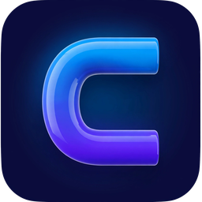

<p align="center">
  
</p>

<h1 align="center">Conduit</h1>

<p align="center">
  Windows utility: local HTTP CONNECT proxy with TLS fragmentation, DNS-over-HTTPS, and an embedded YouTube viewer (Wails v3 / WebView2).
</p>

<p align="center">
  <a href="https://github.com/foursecondfivefour/conduit/releases/latest"></a>
  <a href="https://github.com/foursecondfivefour/conduit/actions/workflows/ci.yml"></a>
  <a href="LICENSE"></a>
</p>

## Features

| Area | What it does |
|---|---|
| Proxy | HTTP CONNECT on `127.0.0.1:31284` (or next free port), allowlist-enforced |
| DPI evasion | TLS ClientHello fragmentation: 5-byte records, 2-byte records, or off |
| DNS | DoH providers Cloudflare / Google / Quad9, 512-host cache, leak check, blocklist ad blocking |
| YouTube | `m.youtube.com` in WebView2: PiP, background audio, SponsorBlock, Return YouTube Dislike |
| Tray | Strategy, DNS, domains, options, YouTube features, speed test, connection test, updates, language, logs |
| Windows | Autostart, system proxy with snapshot restore, minimize to tray, Kill Switch, `Ctrl+Shift+Y` |
| Languages | RU, EN |
| Updates | Auto-update from GitHub with mandatory SHA256 verification |

## Install

- **Portable:** `conduit.exe` + `conduit-updater.exe` from [latest release](https://github.com/foursecondfivefour/conduit/releases/latest)
- **Installer:** `Conduit-Setup-<version>.exe` → `%LocalAppData%\Programs\Conduit\`

Requires [WebView2 Runtime](https://developer.microsoft.com/microsoft-edge/webview2/). Builds are unsigned, so SmartScreen may warn on first run — see [docs/CODE_SIGNING.md](docs/CODE_SIGNING.md).

## Build

Requires Windows 10 amd64, Go 1.25+, WebView2 Runtime.

```powershell
go generate ./...
go build -trimpath -ldflags="-s -w -H=windowsgui -buildid= -X github.com/foursecondfivefour/conduit/internal/config.Version=1.3.0" -tags production -o build\conduit.exe .
go build -trimpath -ldflags="-s -w -H=windowsgui -buildid=" -tags production -o build\conduit-updater.exe .\cmd\conduit-updater
```

Or `make build` / `make release`. CI: [.github/workflows/ci.yml](.github/workflows/ci.yml).

## Run

```powershell
.\build\conduit.exe
```

Splash → first-run onboarding → proxy on `127.0.0.1:31284` → YouTube window. Everything else is controlled from the tray icon.

## Flags

| Flag | Effect |
|---|---|
| `-portable` | Store settings and logs next to the executable (`.\Conduit\`) |
| `-no-gui` | Proxy only, no window or WebView (lowest RAM) |
| `-system-proxy` | Enable the Windows system proxy (use with `-no-gui`) |
| `-debug` | Debug-level logging, DevTools, remote debugging port `9222` (non-production builds) |
| `-debug-inspector` | Open the inspector on the YouTube window at startup (requires `-debug`) |
| `-pprof=:6060` | HTTP pprof on `127.0.0.1:6060` |
| `-memprofile=<path>` | Write a heap profile on exit |

## Data locations

| Item | Installed | Portable |
|---|---|---|
| Settings | `%AppData%\Conduit\preferences.json` | `.\Conduit\preferences.json` |
| Logs | `%AppData%\Conduit\logs\conduit.log` | `.\Conduit\logs\conduit.log` |
| WebView2 profile | `%AppData%\Conduit\webview2\` | `.\Conduit\webview2\` |

The log rotates at 5 MB. Open it from the tray: **Open log**.

## Verify the proxy

```powershell
curl.exe -x http://127.0.0.1:31284 https://www.youtube.com -I
```

## Tests

```powershell
go test ./...
go test -race ./...
```

Debug builds, pprof, and soak testing: [docs/DEBUGGING.md](docs/DEBUGGING.md).

## Security

- The proxy binds `127.0.0.1` only; CONNECT targets pass an allowlist (default: YouTube and Google domains).
- The system proxy routes other local apps through Conduit — enable it deliberately.
- Custom domains are validated; TLDs, IP addresses, and broad suffixes such as `com` are rejected.
- Updates use HTTPS, a GitHub host allowlist, mandatory SHA256, and a PE header check.
- Builds are unsigned. Threat model: [docs/SECURITY.md](docs/SECURITY.md).

## Troubleshooting

| Symptom | Fix |
|---|---|
| SmartScreen warning | Expected for unsigned builds, see CODE_SIGNING.md |
| YouTube does not load | Switch fragmentation strategy, run the connection test, flush the DNS cache |
| Other apps lose connectivity | Turn off the system proxy in the tray before quitting |
| Update fails | Download manually from GitHub; check antivirus lock on `conduit.exe` |

## Disclaimer

Traffic filtering and circumvention are regulated differently by jurisdiction. Compliance with local law is the user's responsibility. The software is provided as-is, without warranty.

## License

MIT — see [LICENSE](LICENSE).
